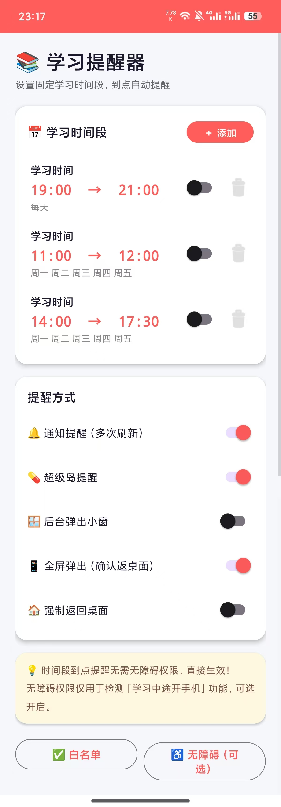
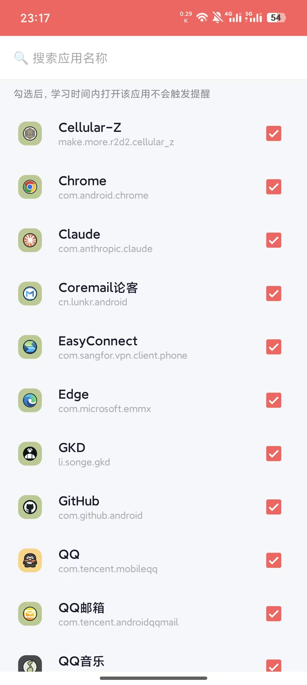

# StudyReminder 学习提醒器

`StudyReminder` 是一个面向 Android 的固定学习时段提醒应用。你可以设置每周重复的学习时间段，并选择通知、悬浮窗、全屏提醒、回到桌面等不同的提醒方式；如果启用了无障碍服务和白名单，它还可以在学习时段检测你是否切到了不该打开的应用。

本项目由我与 AI 协作完成开发与整理，包括代码实现、问题修复、文档整理与 GitHub 发布流程。

## 项目特点

- 支持按星期配置固定学习时间段
- 基于 `AlarmManager` 的到点提醒
- 支持多种提醒方式：
  普通通知、顶部动态提醒、小窗提醒、全屏提醒、强制回桌面
- 支持学习期间的应用白名单
- 可选开启无障碍服务，用于检测学习中途切到分心应用
- 学习时间开始后会启动前台计时服务

## 界面截图

主界面：



白名单设置：



## APK 下载

当前仓库内提供了一个可直接下载的调试版 APK：

- [下载 StudyReminder-debug.apk](apk/StudyReminder-debug.apk)

说明：

- 这是 `debug` 构建，适合体验和测试
- 首次安装时，Android 可能会提示“未知来源安装”
- 如果后续你要发正式版本，建议再单独做 `release` 签名包

## 开发信息

- 开发语言：Kotlin
- UI 方式：Android View + ViewBinding
- `compileSdk`：34
- `minSdk`：29
- `targetSdk`：34
- 本地存储：SharedPreferences

## 使用方式

1. 新建一个或多个学习时间段，例如 `10:00 - 11:30`
2. 选择每周生效的日期
3. 打开你想使用的提醒方式
4. 到达学习时间后，应用会自动开始提醒
5. 如果启用了无障碍和白名单，学习过程中切到非白名单应用时也会再次提醒

## 权限说明

| 权限 | 用途 |
| --- | --- |
| `POST_NOTIFICATIONS` | 发送提醒通知 |
| `SYSTEM_ALERT_WINDOW` | 显示悬浮窗、小窗、顶部动态提醒 |
| `FOREGROUND_SERVICE` | 保持学习计时服务运行 |
| `USE_FULL_SCREEN_INTENT` | 显示全屏提醒 |
| `SCHEDULE_EXACT_ALARM` | 提高固定学习时段提醒的准确性 |
| 无障碍服务 | 可选，用于学习期间检测应用切换 |

## 运行项目

1. 使用 Android Studio 打开项目根目录
2. 等待 Gradle 同步完成
3. 运行 `app` 模块到真机或模拟器

命令行构建：

```powershell
.\gradlew.bat assembleDebug
```

代码检查：

```powershell
.\gradlew.bat lintDebug
```

## 项目结构

```text
app/src/main/
├── java/com/study/reminder/
│   ├── helper/      # 通知、调度、白名单、提醒文案等辅助逻辑
│   ├── model/       # 学习时间段模型与本地仓库
│   ├── service/     # 计时、悬浮窗、开机恢复、无障碍服务
│   ├── ui/          # Activity 与列表适配器
│   └── viewmodel/   # 简单状态管理
└── res/
    ├── drawable/
    ├── layout/
    ├── mipmap/
    ├── values/
    └── xml/
```

## 当前说明

- 当前主流程不依赖外部 AI 服务也能正常工作
- 仓库中保留了 AI 相关辅助代码，但目前核心提醒流程主要还是本地实现
- 不同 Android 厂商对悬浮窗、全屏意图、精确闹钟的限制可能略有差异

## 许可

目前仓库还没有添加开源许可证。在明确选择许可证之前，默认保留所有权利。
