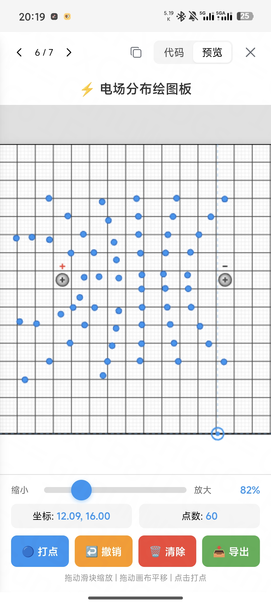

# StudyReminder

StudyReminder is an Android study reminder app for fixed study slots. You can set recurring time ranges, choose how reminders are delivered, and optionally use an accessibility service plus a whitelist to detect when you leave study mode and switch to distracting apps.

The project is built with the classic Android View system in Kotlin and focuses on a direct, device-side reminder workflow rather than cloud-dependent features.

## Features

- Fixed recurring study slots with weekday selection
- Exact-alarm based reminders for scheduled study time
- Multiple reminder styles including notification, dynamic-island style overlay, floating small window, full-screen reminder, and force return to home screen
- Optional accessibility-assisted interruption detection
- App whitelist for allowed apps during study time
- Foreground countdown service during active study sessions

## Screenshots

Main screen:


Whitelist management:


Project experiment slide:



## Tech Stack

- Kotlin
- Android SDK 34
- Android ViewBinding
- AlarmManager
- Foreground Service
- AccessibilityService
- SharedPreferences for local persistence

## Requirements

- Android Studio Hedgehog or newer should work
- Android 10+ device or emulator
- `minSdk 29`
- `targetSdk 34`

## Getting Started

1. Clone this repository.
2. Open the project root in Android Studio.
3. Let Gradle sync finish.
4. Run the `app` module on a device or emulator.

If you prefer the command line:

```bash
./gradlew assembleDebug
```

On Windows:

```powershell
.\gradlew.bat assembleDebug
```

## How It Works

1. Create one or more study slots such as `10:00-11:30` on selected weekdays.
2. The app schedules alarms for the next active slot.
3. When the slot starts, a foreground timer service begins running.
4. Depending on your settings, the app shows reminders through notifications, overlays, full-screen UI, or a forced home-screen jump.
5. If accessibility mode is enabled, the app can watch app switches during study time and trigger reminders when you open a non-whitelisted app.

## Permissions

| Permission | Purpose |
| --- | --- |
| `POST_NOTIFICATIONS` | Show reminder notifications |
| `SYSTEM_ALERT_WINDOW` | Show overlays and floating windows |
| `FOREGROUND_SERVICE` | Keep the study timer alive |
| `USE_FULL_SCREEN_INTENT` | Show full-screen reminder notifications |
| `SCHEDULE_EXACT_ALARM` | Improve time accuracy for scheduled study slots |
| Accessibility service | Optional, used for app-switch detection during study time |

## Project Structure

```text
app/src/main/
├── java/com/study/reminder/
│   ├── helper/      # notifications, scheduling, whitelist, message helpers
│   ├── model/       # slot model and local repository
│   ├── service/     # timer, overlays, boot receiver, accessibility service
│   ├── ui/          # activities and adapters
│   └── viewmodel/   # simple UI state holder
└── res/
    ├── drawable/
    ├── layout/
    ├── mipmap/
    ├── values/
    └── xml/
```

## Current Notes

- The main reminder flow currently works locally without requiring any external AI service.
- There is AI-related helper code in the repository, but the current shipped UI is centered on local reminder behavior and local taunt messages.
- Overlay, full-screen, and exact-alarm behavior may vary slightly across Android vendors because of system permission and background-launch policies.

## Development

Useful commands:

```powershell
.\gradlew.bat assembleDebug
.\gradlew.bat lintDebug
```

## License

No license has been added yet. All rights reserved by default until a license is chosen.
